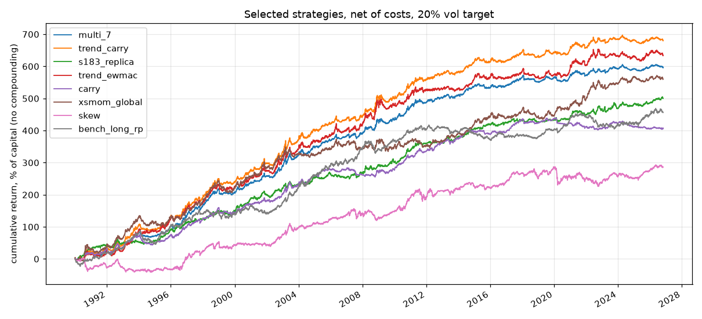
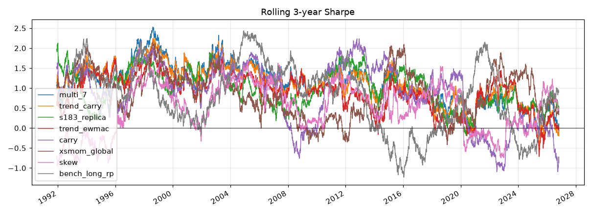
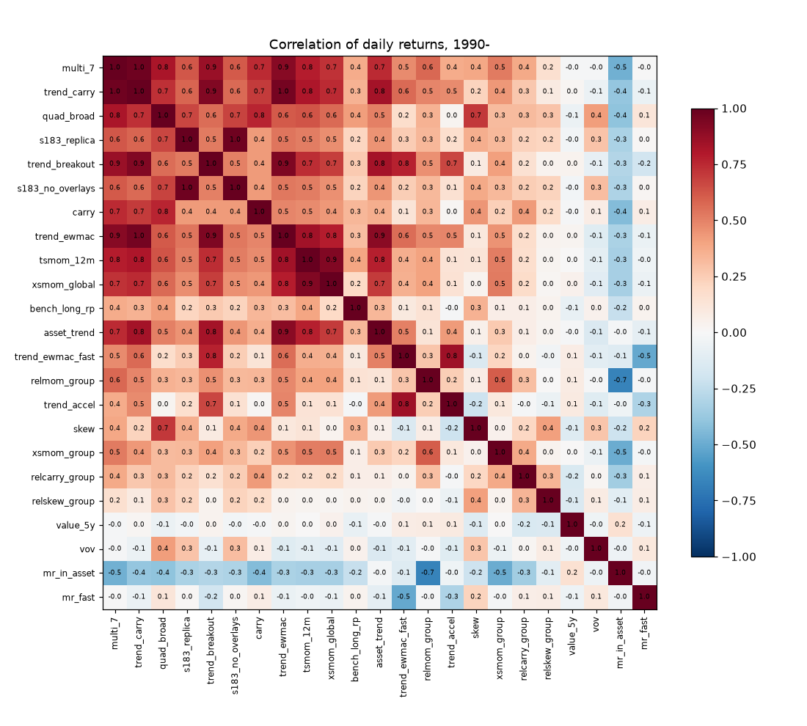

# Strategy scorecard

Data 1990-01-02 to 2026-10-26. Statistics from 1990, net of spread, commission and roll costs, 20% annual vol target, fixed capital. `SR hc` is the Sharpe after a Bonferroni multiple-testing haircut over all strategies in the table; `DSR` is the deflated-Sharpe probability. `live` columns cover P&L after the date a strategy entered the library.

| strategy | family | SR | SR hc | t(HAC) | vol | maxDD | 90s | 00s | 10s | 20s | last 5y | post-Mar24 | cost SR | corr trend | corr long | DSR | live SR | live days |
|---|---|---|---|---|---|---|---|---|---|---|---|---|---|---|---|---|---|---|
| multi_7 | composite | 1.14 | 1.06 | 6.5 | 14% | -26% | 1.45 | 1.35 | 1.02 | 0.41 | 0.30 | -0.26 | 0.16 | 0.91 | 0.37 | 1.00 |  | 0 |
| trend_carry | composite | 1.10 | 1.02 | 6.3 | 16% | -30% | 1.43 | 1.28 | 0.98 | 0.40 | 0.17 | -0.46 | 0.15 | 0.95 | 0.34 | 1.00 |  | 0 |
| quad_broad | composite | 1.02 | 0.93 | 5.8 | 15% | -36% | 1.27 | 1.09 | 1.21 | 0.18 | 0.34 | 0.24 | 0.21 | 0.61 | 0.42 | 0.98 |  | 0 |
| s183_replica | composite | 0.99 | 0.90 | 5.9 | 14% | -21% | 1.19 | 0.99 | 1.07 | 0.68 | 0.64 | 0.60 | 0.18 | 0.54 | 0.22 | 0.98 |  | 0 |
| trend_breakout | trend | 0.98 | 0.88 | 5.7 | 18% | -34% | 1.29 | 1.22 | 0.62 | 0.58 | 0.16 | -0.23 | 0.20 | 0.93 | 0.26 | 0.97 |  | 0 |
| s183_no_overlays | composite | 0.97 | 0.88 | 5.8 | 18% | -30% | 1.09 | 1.07 | 1.04 | 0.65 | 0.55 | 0.64 | 0.19 | 0.52 | 0.23 | 0.97 |  | 0 |
| carry | carry | 0.92 | 0.81 | 5.2 | 12% | -37% | 1.11 | 1.01 | 1.40 | -0.49 | -0.17 | -1.12 | 0.16 | 0.49 | 0.33 | 0.93 |  | 0 |
| trend_ewmac | trend | 0.89 | 0.77 | 5.0 | 19% | -37% | 1.18 | 1.08 | 0.59 | 0.51 | 0.19 | -0.21 | 0.13 | 1.00 | 0.31 | 0.91 |  | 0 |
| tsmom_12m | trend | 0.89 | 0.77 | 4.9 | 18% | -58% | 1.14 | 0.87 | 0.59 | 0.95 | 0.58 | 0.05 | 0.12 | 0.84 | 0.39 | 0.91 |  | 0 |
| xsmom_global | momentum | 0.83 | 0.70 | 4.6 | 18% | -39% | 1.16 | 0.62 | 0.59 | 0.99 | 0.65 | -0.08 | 0.15 | 0.78 | 0.20 | 0.84 |  | 0 |
| bench_long_rp | benchmark | 0.82 | 0.70 | 4.6 | 15% | -49% | 0.94 | 1.31 | 0.31 | 0.48 | 0.08 | 0.66 | 0.11 | 0.31 | 1.00 | 0.83 |  | 0 |
| asset_trend | trend | 0.81 | 0.69 | 4.6 | 22% | -44% | 0.94 | 1.00 | 0.49 | 0.71 | 0.47 | 0.14 | 0.11 | 0.90 | 0.33 | 0.81 |  | 0 |
| trend_ewmac_fast | trend | 0.57 | 0.40 | 3.3 | 20% | -46% | 0.86 | 0.77 | 0.13 | 0.40 | -0.08 | -0.34 | 0.29 | 0.56 | 0.10 | 0.28 |  | 0 |
| relmom_group | momentum | 0.52 | 0.34 | 3.1 | 9% | -29% | 0.68 | 0.94 | 0.06 | 0.23 | 0.05 | 0.18 | 0.20 | 0.48 | 0.14 | 0.19 |  | 0 |
| trend_accel | trend | 0.49 | 0.29 | 2.9 | 19% | -77% | 0.92 | 0.80 | -0.02 | 0.10 | -0.28 | -0.22 | 0.20 | 0.49 | -0.02 | 0.15 |  | 0 |
| skew | skew | 0.48 | 0.24 | 2.7 | 16% | -61% | 0.28 | 0.69 | 0.80 | 0.01 | 0.49 | 0.65 | 0.13 | 0.11 | 0.35 | 0.13 |  | 0 |
| xsmom_group | momentum | 0.43 | 0.19 | 2.5 | 8% | -30% | 0.61 | 0.81 | -0.18 | 0.16 | 0.14 | -0.09 | 0.24 | 0.45 | 0.07 | 0.08 |  | 0 |
| relcarry_group | carry | 0.34 | 0.00 | 1.9 | 7% | -25% | 0.61 | 0.56 | -0.00 | 0.01 | -0.11 | -0.52 | 0.24 | 0.18 | 0.07 | 0.03 |  | 0 |
| relskew_group | skew | 0.27 | 0.00 | 1.6 | 8% | -44% | 0.22 | 0.45 | 0.12 | 0.41 | 0.21 | -0.38 | 0.23 | 0.04 | 0.03 | 0.01 |  | 0 |
| value_5y | value | -0.05 | -0.05 | -0.3 | 8% | -61% | -0.18 | -0.00 | -0.41 | 0.51 | 0.87 | 1.22 | 0.18 | 0.03 | -0.08 | 0.00 |  | 0 |
| vov | vol | -0.19 | -0.19 | -1.1 | 13% | -129% | -0.15 | -0.24 | 0.16 | -0.55 | -0.51 | 0.44 | 0.39 | -0.12 | 0.04 | 0.00 |  | 0 |
| mr_in_asset | mean_reversion | -0.63 | -0.63 | -3.7 | 12% | -348% | -0.99 | -1.17 | -0.85 | 0.32 | 0.47 | 0.37 | 0.15 | -0.32 | -0.23 | 0.00 |  | 0 |
| mr_fast | mean_reversion | -2.02 | -2.02 | -11.9 | 19% | -1434% | -3.31 | -1.85 | -1.68 | -1.08 | -0.64 | 0.24 | 1.17 | -0.06 | 0.03 | 0.00 |  | 0 |

## Sharpe by sector (each strategy's P&L split by where it was earned)

| strategy | Commodities | Crypto | Equity | FX | Rates |
|---|---|---|---|---|---|
| multi_7 | 0.82 | 0.04 | 0.39 | 0.50 | 0.82 |
| trend_carry | 0.76 | 0.06 | 0.36 | 0.47 | 0.84 |
| quad_broad | 0.62 | -0.32 | 0.42 | 0.46 | 0.76 |
| s183_replica | 0.67 | -0.01 | 0.31 | 0.47 | 0.62 |
| trend_breakout | 0.70 | 0.35 | 0.31 | 0.45 | 0.71 |
| s183_no_overlays | 0.65 | -0.13 | 0.36 | 0.46 | 0.61 |
| carry | 0.36 | -0.38 | 0.23 | 0.39 | 0.79 |
| trend_ewmac | 0.69 | 0.02 | 0.34 | 0.34 | 0.66 |
| tsmom_12m | 0.78 | 0.17 | 0.31 | 0.31 | 0.59 |
| xsmom_global | 0.61 | 0.13 | 0.34 | 0.30 | 0.57 |
| bench_long_rp | 0.47 | 0.65 | 0.34 | 0.17 | 0.62 |
| asset_trend | 0.64 | 0.09 | 0.37 | 0.06 | 0.64 |
| trend_ewmac_fast | 0.43 | 0.58 | 0.05 | 0.28 | 0.47 |
| relmom_group | 0.44 | 0.15 | -0.01 | 0.38 | 0.22 |
| trend_accel | 0.36 | 0.40 | -0.06 | 0.22 | 0.54 |
| skew | 0.35 | -0.01 | 0.32 | 0.24 | 0.21 |
| xsmom_group | 0.49 | 0.12 | -0.10 | 0.30 | 0.05 |
| relcarry_group | 0.19 | -0.44 | 0.10 | 0.30 | 0.07 |
| relskew_group | 0.24 | 0.19 | 0.23 | -0.06 | 0.19 |
| value_5y | -0.24 | -0.18 | -0.08 | 0.27 | -0.11 |
| vov | -0.48 | -0.52 | 0.08 | 0.04 | 0.09 |
| mr_in_asset | -0.42 | 0.02 | -0.21 | -0.27 | -0.46 |
| mr_fast | -2.01 | -0.58 | -0.80 | -0.49 | -1.42 |

